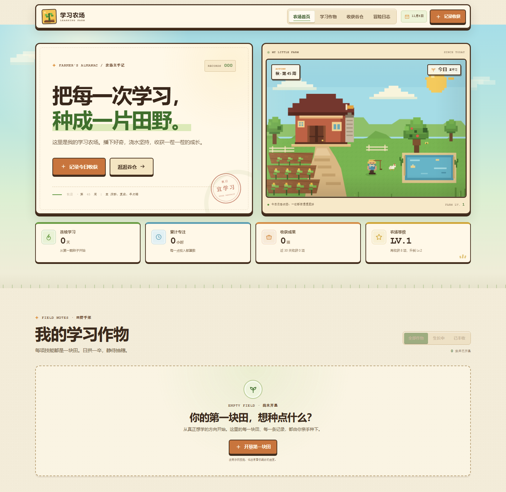

# 学习农场 · Learning Farm

一个星露谷物语风格的个人学习成果记录页。没有构建步骤，也没有外部依赖，双击 `index.html` 就能打开。



## 这是一个空农场

页面里**没有预置的学习记录、技能、时长、等级或勋章**。第一次打开时：

- 所有统计都是 0；
- 学习田地是空的；
- 荣誉墙全部锁定；
- 本周图表没有数据；
- 冒险日志只有一句“农场还是一张白纸”。

先点「开垦第一块田」，给你的学习方向起名字、选一个像素作物，再记录第一笔真实收获。之后所有数字都从你的记录里算出来。

## 现在有什么

- **像素农场首页**：SVG 农场、当前季节和周数、农场等级和四项学习总览。
- **自定义学习田**：可以开垦任意数量的田，自己命名方向和作物，并选择藤蔓、花朵、蘑菇、麦穗、小树或四叶草精灵。
- **学习作物**：生长进度按累计学习时长换算（每小时 2.5%，40 小时成熟），可以筛选「生长中 / 已丰收」。
- **收获谷仓**：本周专注时长柱状图、荣誉勋章墙和升级提示全部根据真实记录动态生成；每累计 8 条收获升 1 级。
- **冒险日志**：按日期排列学习记录，支持按学习田筛选、展开全部记录。
- **新增收获**：填写成果、学习田、时长、日期、状态和笔记，保存后自动更新统计、图表、作物进度和勋章。
- **数据导出**：页脚「导出记录」可以把当前数据下载为 JSON 备份。
- **响应式**：桌面、平板、手机均可用，包含移动端菜单、键盘焦点和减少动态效果支持。

## 直接打开

在文件管理器中双击 `index.html`，或用任意静态服务器打开这个目录。

页面不需要安装任何依赖。

## 数据说明

记录保存在当前浏览器的 `localStorage` 中，键名为 `learning-farm:v2`。它不会上传到任何服务器，也不会跨浏览器自动同步。换浏览器或清理站点数据前，记得先导出备份。

旧版本的示例数据使用 `learning-farm:v1`，页面会在启动时自动清理，不会带入新农场。

如果想彻底重置所有内容，可以在浏览器控制台执行：

```js
localStorage.removeItem("learning-farm:v2");
location.reload();
```

## 文件说明

| 文件 | 内容 |
| --- | --- |
| `index.html` | 页面结构、像素农场 SVG、图标和弹窗 |
| `styles.css` | 视觉系统、布局、动效和响应式规则 |
| `app.js` | 空状态、学习田创建、记录保存、统计计算和导出 |
| `favicon.svg` | 像素幼苗站点图标 |
| `preview.png` | 页面预览图 |
